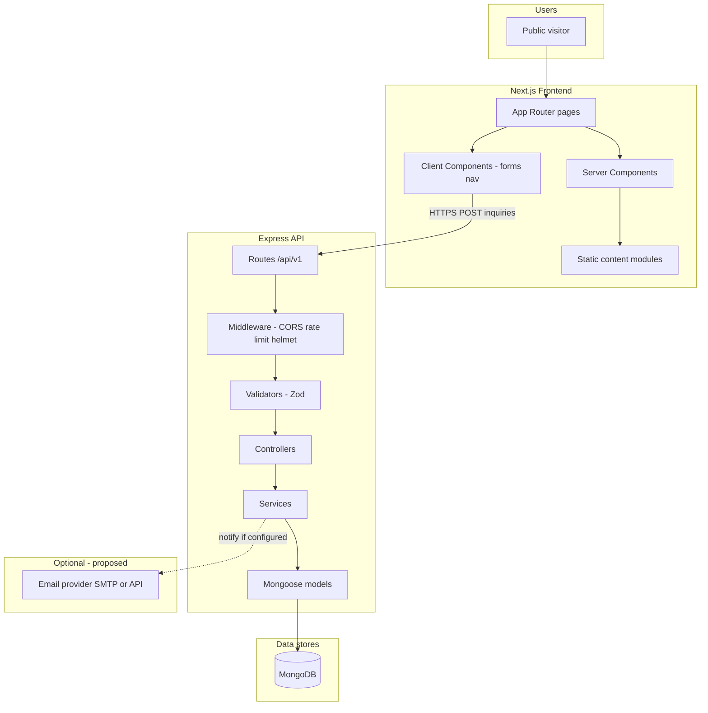
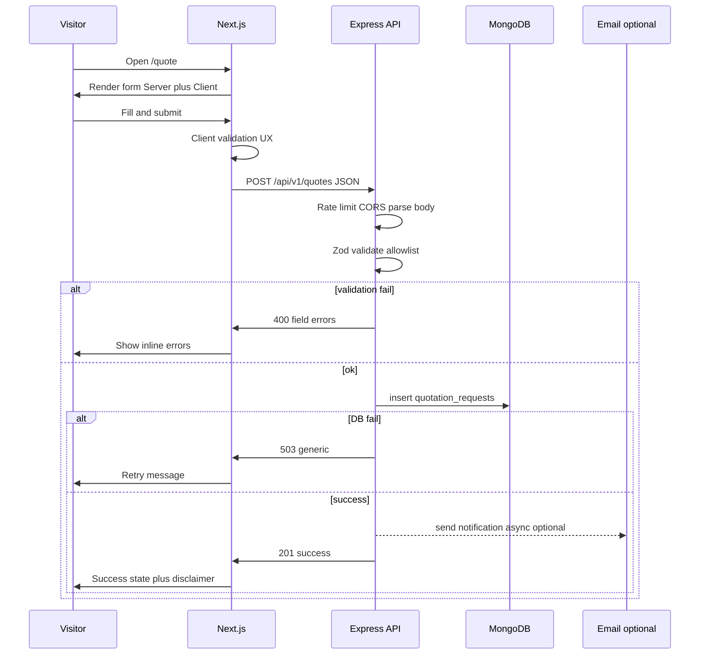

# Technical Architecture

## ELITE WORKSHOP LTD — Corporate Website

| Document | Details |
|----------|---------|
| **Version** | 1.0 (Draft) |
| **Status** | Architecture planning — implementation not started |
| **References** | `docs/BRD.md` v1.0, `docs/SRS.md` v1.0 |
| **Stack (fixed)** | Next.js (App Router, TypeScript, Tailwind), Express (TypeScript), MongoDB (Mongoose proposed) |

---

## 1. Document Purpose

This document defines the **implementation-ready technical architecture** for the ELITE WORKSHOP LTD public website: component boundaries, repository layout, API design, database collections, security, configuration, development workflow, deployment, and testing.

It **does not** include application code, package installation, or UI design.

---

## 2. References to BRD and SRS

| Source | Extracted inputs used in this architecture |
|--------|---------------------------------------------|
| **BRD** | MVP pages; BR-001–BR-009, BR-019, BR-020; no e-commerce/admin; ASM-001–005; CON-001–003; open business questions |
| **SRS** | Sitemap (Section 5); FR-001–FR-092 (MVP subset); Sections 11–14 (data, logical APIs, errors); NFR-SEC/PRIV/RSP; DEC-001, DEC-002, DEC-003; OQ-001–OQ-013 |

### 2.1 Contradictions and unresolved items (carried forward)

| ID | Issue | Architecture stance |
|----|-------|---------------------|
| Portfolio vs. empty launch | BR-003 vs. BR-004 | Support static project list (may be empty array) + configured empty-state message |
| DEC-001 | DB vs. static for services/portfolio | **Proposed (TAD-002):** MVP uses **version-controlled static content** in the frontend; MongoDB for **inquiries only** |
| DEC-002 | Email vs. DB for inquiries | **Proposed (TAD-003):** **Persist in MongoDB always**; **optional email notification** (best-effort, non-blocking) |
| DEC-003 | Contact: email, phone, or either | **Proposed (TAD-004):** Require **at least one of** email or phone |
| BRD/SRS acceptance | Draft status | Implementation may proceed against docs; business sign-off tracked in readiness checklist |

---

## 3. Architecture Goals and Constraints

### 3.1 Goals

| Goal | How architecture supports it |
|------|------------------------------|
| Professional public site | Next.js SSR/SSG for pages, SEO, performance |
| Trustworthy content | Static content layer; no fake data; config-driven contact |
| Lead capture | Express-validated writes to MongoDB |
| Maintainability | Monorepo, thin controllers, shared conventions |
| Security baseline | Server-side validation, rate limits, secrets server-only |

### 3.2 Constraints (non-negotiable)

- **CON-001:** Next.js + TypeScript + Tailwind; Express + TypeScript; MongoDB.
- **CON-002:** Express is the **only** backend for inquiry processing and persistence validation—not duplicated in Next.js route handlers.
- **CON-003:** No auth, admin CMS, payments, or CRM in MVP unless change-approved.
- **CON-004:** No invented business facts in config defaults.

---

## 4. High-Level Architecture

### 4.1 Component responsibilities

| Component | Responsibilities | Does **not** do |
|-----------|------------------|-----------------|
| **Next.js (client/)** | Page rendering (App Router); layouts; navigation; metadata/SEO; sitemap/robots; static/service/project content loading; client form UX validation; loading/success/error UI; image optimization | Persist inquiries; authoritative validation; direct MongoDB access |
| **Express (server/)** | HTTP API; server-side validation; rate limiting; security headers; inquiry services; Mongoose persistence; optional email dispatch; structured errors/logging | Render marketing pages |
| **MongoDB** | Store contact inquiries and quotation requests (MVP); optional future content if DEC-001 changes | Serve public page HTML |

### 4.2 Architecture diagram



**Decision status:** Split frontend/backend deployment — **proposed** (typical: Vercel/similar for Next.js + Render/Fly/VPS for Express + MongoDB Atlas).

---

## 5. Frontend Architecture

### 5.1 App Router structure (proposed)

```
client/src/app/
├── layout.tsx              # Root layout: header, footer, fonts
├── page.tsx                # Home
├── about/page.tsx
├── services/
│   ├── page.tsx            # Overview
│   └── [serviceSlug]/page.tsx
├── projects/
│   ├── page.tsx
│   └── [projectSlug]/page.tsx
├── contact/page.tsx
├── quote/page.tsx
├── privacy/page.tsx
├── not-found.tsx           # Custom 404
├── sitemap.ts              # Dynamic sitemap from published projects
└── robots.ts
```

### 5.2 Server vs. client components

| Area | Default | Client component when |
|------|---------|------------------------|
| Layout shell, header/footer structure | Server | Mobile menu open/close, focus trap |
| Marketing sections, service/project body | Server | — |
| Metadata (`generateMetadata`) | Server | — |
| Contact / quote forms | Wrapper Server | Form state, submit, inline errors, disable-on-submit |
| Portfolio filter (post-MVP) | Server list + Client filter UI | If client-side filter (FR-034) |
| Image gallery lightbox | — | If implemented (Could Have) |

**Rule:** Prefer Server Components for data-heavy, SEO-critical, non-interactive UI. Add `"use client"` only for interactivity (forms, menu, client-only hooks).

### 5.3 Feature and component organization

```
client/src/
├── components/
│   ├── layout/       # Header, Footer, Nav, MobileMenu, SkipLink
│   ├── ui/           # Button, Input, Textarea, Select, Alert (accessible primitives)
│   └── seo/          # JsonLd organization (conditional fields only)
├── features/
│   ├── services/     # ServiceCard, ServiceDetailSections
│   ├── projects/     # ProjectGrid, ProjectCard, EmptyPortfolio, ProjectGallery
│   ├── contact/      # ContactForm, ContactDetails
│   └── quote/        # QuoteForm, QuoteDisclaimer
├── content/          # services.ts, projects.ts, pages.ts, privacy.md (owner-approved)
├── config/
│   └── site.ts       # Company name, contact fields from env + safe defaults
├── lib/
│   ├── api/          # submitContact, submitQuote (calls Express)
│   ├── metadata.ts   # Title/description helpers
│   └── validation/   # Client-side Zod schemas (mirror server rules for UX only)
├── types/            # Shared TS types (inquiry DTOs, content types)
└── hooks/            # useMediaQuery etc. if needed sparingly
```

### 5.4 Content and placeholders (no fabricated facts)

| Content type | MVP source | Empty / missing behavior |
|--------------|------------|---------------------------|
| Company name | `ELITE WORKSHOP LTD` (confirmed) + `site.ts` | Always show legal name |
| Phone, email, address, hours | Env / config — **empty until owner provides** | Hide `tel:`, `mailto:`, map; show neutral “Contact details will be published here” only if owner approves stub text |
| Service copy | `content/services.ts` — owner-approved strings or explicit `[PENDING OWNER COPY]` marker in dev | Never auto-fill industry examples as facts |
| Decorated Furniture scope | `scopeNotice` field; null until BR-019 resolved | Render owner-approved pending stub (US-007) |
| Projects | `content/projects.ts` — array; default `[]` | `EmptyPortfolio` with `portfolioEmptyStateMessage` from config (BR-004) |
| Project images | Paths under `public/projects/` | If `images.length === 0`, text-only detail block; no stock photos as ELITE work |
| Privacy | `content/privacy.md` or CMS later | Forms disabled in production until file non-empty (NFR-PRIV-003) |

**Build-time check (proposed):** Script or CI step fails production build if forms enabled but privacy content empty.

### 5.5 Forms and API invocation

| Decision ID | Topic | Status |
|-------------|-------|--------|
| **TAD-001** | How the browser reaches Express | **Proposed:** Client Component `fetch` POST to **`NEXT_PUBLIC_API_BASE_URL`** with CORS allowlist **OR** Server Action that forwards body to Express using server-only `API_BASE_URL` (no duplicate validation). **Recommended:** Server Action forwarder to keep API URL private and reduce CORS surface. |

Server Action **must not** re-implement business rules beyond assembling the request; Express + Zod remain authoritative (NFR-SEC-001).

### 5.6 SEO and images

- Per-page `metadata` / `generateMetadata` from content config (NFR-SEO-001).
- `next/image` for project and hero assets (NFR-PERF-002).
- JSON-LD `Organization` only with configured, confirmed fields (NFR-SEO-005).

### 5.7 Styling

- Tailwind CSS with design tokens in `tailwind.config` referencing brand colors when provided.
- Responsive breakpoints aligned with SRS: `<768`, `768–1023`, `≥1024` (NFR-RSP-001).

---

## 6. Backend Architecture

### 6.1 Layered structure

```
server/src/
├── app.ts                 # Express app factory, middleware registration
├── server.ts              # listen(), graceful shutdown
├── config/
│   ├── env.ts             # Typed env parsing (Zod)
│   └── database.ts        # Mongo connection
├── routes/
│   ├── index.ts           # Mount /api/v1
│   ├── contact.routes.ts
│   └── quotes.routes.ts
├── controllers/
│   ├── contact.controller.ts
│   └── quotes.controller.ts
├── services/
│   ├── contact.service.ts
│   ├── quotes.service.ts
│   └── notification.service.ts   # Optional email
├── validators/
│   ├── contact.schema.ts
│   └── quote.schema.ts
├── models/
│   ├── ContactInquiry.model.ts
│   └── QuotationRequest.model.ts
├── middleware/
│   ├── errorHandler.ts
│   ├── notFound.ts
│   ├── rateLimiter.ts
│   └── requestId.ts
└── utils/
    ├── ApiError.ts
    └── logger.ts
```

### 6.2 Layer responsibilities

| Layer | Responsibility | Depends on |
|-------|----------------|------------|
| **Routes** | HTTP method + path mapping | Controllers |
| **Controllers** | Parse request, call service, map to HTTP status | Services, validators |
| **Validators** | Zod parse/strip unknown fields | Schemas |
| **Services** | Business flow: persist, notify, dedupe window | Models, notification |
| **Models** | Mongoose schema, indexes | MongoDB |
| **Middleware** | Cross-cutting: CORS, helmet, rate limit, body limit, errors | Config |

Controllers stay **thin** (no embedded Mongo queries).

### 6.3 API response conventions

**Success (2xx):**

```json
{
  "success": true,
  "data": null,
  "meta": { "requestId": "uuid" }
}
```

**Validation error (400):**

```json
{
  "success": false,
  "error": {
    "code": "VALIDATION_ERROR",
    "message": "Invalid input.",
    "fields": [
      { "path": "phone", "message": "Phone is required." }
    ]
  },
  "meta": { "requestId": "uuid" }
}
```

**Rate limit (429):**

```json
{
  "success": false,
  "error": {
    "code": "RATE_LIMITED",
    "message": "Too many requests. Please try again later."
  }
}
```

**Service unavailable (503):**

```json
{
  "success": false,
  "error": {
    "code": "SERVICE_UNAVAILABLE",
    "message": "Unable to submit your request. Please try again or contact us directly."
  }
}
```

Never return stack traces or MongoDB errors to clients (SRS Section 13).

### 6.4 Supporting libraries (proposed — verify versions at install time)

| Concern | Proposed package | Justification |
|---------|------------------|---------------|
| Validation | `zod` | SRS allowlist validation; shared rules |
| HTTP hardening | `helmet` | NFR-SEC-006 |
| CORS | `cors` | NFR-SEC-007 |
| Rate limiting | `express-rate-limit` | NFR-SEC-002 |
| MongoDB ODM | `mongoose` | Project constraint |
| Logging | `pino` + `pino-http` | NFR-PRIV-004, ops |
| Email (optional) | `nodemailer` or provider SDK | DEC-002 notification |
| Testing | `vitest`, `supertest` | API tests |
| Lint/format | `eslint`, `prettier`, `@typescript-eslint/*` | NFR-MNT-003 |

Record resolved versions in lockfiles when implementation starts; do not pin guessed versions in this document.

---

## 7. API Design

**Prefix (proposed):** `/api/v1`  
**Content-Type:** `application/json`  
**Max body size (proposed):** 32 KB (SRS Section 12.1)

### 7.1 POST `/api/v1/contact`

| Attribute | Specification |
|-----------|---------------|
| **Purpose** | Submit contact inquiry (FR-050–054, SRS 12.1) |
| **Auth** | None (public) |
| **Request body** | See table below |
| **Success** | `201 Created` + success envelope |
| **Errors** | `400`, `413`, `415`, `429`, `503` |

| Field | Required | Validation |
|-------|----------|------------|
| `fullName` | Yes | string, trim, 2–100 |
| `email` | Conditional | valid email if present; **TAD-004:** at least one of `email` or `phone` |
| `phone` | Conditional | string, trim, 6–30 **(proposed)** |
| `message` | Yes | string, 10–5000 |
| `preferredContactMethod` | No | enum: `phone`, `email`, `whatsapp` |
| `website` | No | honeypot — must be empty **(proposed)** |

**Security:** Rate limit (e.g. 10 / 15 min / IP); strip unknown keys; NoSQL injection safe via Zod + Mongoose.

### 7.2 POST `/api/v1/quotes`

| Attribute | Specification |
|-----------|---------------|
| **Purpose** | Submit quotation **inquiry** (FR-060–067, SRS 12.2) — not a binding quote |
| **Auth** | None |

| Field | Required | Validation |
|-------|----------|------------|
| `fullName` | Yes | 2–100 |
| `phone` | Yes | non-empty, format check **(proposed)** |
| `email` | No | valid if present |
| `serviceCategory` | Yes | enum: `pvc-works`, `aluminium-works`, `kitchen-furniture`, `decorated-furniture` |
| `projectDescription` | Yes | 20–8000 |
| `projectLocation` | No | 2–200 if present |
| `preferredContactMethod` | No | enum as above |
| `website` | No | honeypot empty |

**Success:** `201` + `{ success: true }`  
**Errors:** Same classes as contact.

### 7.3 Endpoints explicitly excluded from MVP

- Authentication, admin CRUD, portfolio CRUD, payments, webhooks (unless approved later).

### 7.4 Operational endpoint (optional, proposed)

| Method | Path | Purpose |
|--------|------|---------|
| GET | `/api/v1/health` | Liveness/readiness for deployment; returns `{ status: "ok" }` without DB details |

Not required by SRS; useful for hosting health checks. **Status: proposed.**

---

## 8. Database Design Overview

### 8.1 MVP collections (proposed — TAD-002)

| Collection | Include in MVP? | Rationale |
|------------|-----------------|-----------|
| `contact_inquiries` | **Yes** | Persistent lead capture (DEC-002) |
| `quotation_requests` | **Yes** | Persistent lead capture |
| `projects` | **No (MVP)** | Static content unless DEC-001 reversed |
| `services` | **No (MVP)** | Static content |

### 8.2 Collection: `contact_inquiries`

| Field | Type | Required | Notes |
|-------|------|----------|-------|
| `_id` | ObjectId | auto | |
| `fullName` | string | yes | indexed only if needed for ops search — **avoid** public query |
| `email` | string | conditional | lowercase trim |
| `phone` | string | conditional | |
| `message` | string | yes | |
| `preferredContactMethod` | string | no | enum |
| `source` | string | yes | constant `contact` |
| `submittedAt` | Date | yes | default now |
| `clientMeta.ipHash` | string | no | hashed IP **(proposed)** — not raw IP |
| `clientMeta.userAgent` | string | no | optional, truncated |
| `createdAt` / `updatedAt` | Date | yes | Mongoose timestamps |

**Indexes (proposed):**

- `{ submittedAt: -1 }` — operational sorting, retention jobs later
- No text index unless owner needs search in future admin

**Retention:** **Unresolved (OQ-007)** — implement TTL only after legal approval.

### 8.3 Collection: `quotation_requests`

| Field | Type | Required | Notes |
|-------|------|----------|-------|
| `_id` | ObjectId | auto | |
| `fullName` | string | yes | |
| `phone` | string | yes | |
| `email` | string | no | |
| `serviceCategory` | string | yes | enum slug |
| `projectDescription` | string | yes | |
| `projectLocation` | string | no | |
| `preferredContactMethod` | string | no | |
| `status` | string | yes | MVP default `new` — not a sales order state machine |
| `source` | string | yes | `quote` |
| `submittedAt` | Date | yes | |
| `clientMeta` | object | no | same as contact |
| `createdAt` / `updatedAt` | Date | yes | |

**Indexes (proposed):**

- `{ submittedAt: -1 }`
- `{ serviceCategory: 1, submittedAt: -1 }` — owner reporting

**Relationship:** Logical link to service slug only (string enum), no FK collection in MVP.

### 8.4 Data minimization and permissions

- DB user for application: **readWrite** on inquiry collections only **(proposed)**.
- No public MongoDB access; network allowlist (Atlas IP / VPC).
- Submissions are **inquiries**, not orders — no payment or inventory fields.

### 8.5 Static content vs. database (DEC-001 evaluation)

| Approach | Pros | Cons | MVP recommendation |
|----------|------|------|----------------------|
| **Static TS/JSON in repo** | Simple deploy; git review; no admin attack surface | Requires deploy for content changes | **Yes for services, projects, about** |
| **MongoDB-driven content** | Easier non-dev edits later | Needs admin UI or direct DB edits (out of scope) | **Defer** until CMS approved |

---

## 9. Frontend-to-Backend Data Flow

### 9.1 Quotation request flow (Mermaid)



### 9.2 Page navigation flow (read path)

1. Visitor requests URL → Next.js Server Component loads static content.
2. No Express call for standard pages in MVP.
3. Projects/services rendered from `content/*` at build or request time.

### 9.3 Failure modes

| Scenario | Frontend | Backend |
|----------|----------|---------|
| Network timeout | Show retry; keep form values **(proposed)** | — |
| 429 | Message: try later or call if configured | Log count, no PII |
| 503 | Generic message; optional link to `tel:`/`mailto:` if configured | Log error code only |
| Double submit | Disable button; optional 30s client guard (FR-066) | Optional idempotency key **(future)** |
| Invalid JSON | — | 400 |

Client validation **never** replaces server validation.

---

## 10. Security Architecture

| Control | Implementation (proposed) |
|---------|---------------------------|
| Server-side validation | Zod on all write endpoints; reject unknown fields |
| NoSQL injection | Typed schemas; no `$` operators from client input |
| XSS | React escaping; no `dangerouslySetInnerHTML` for user content on public site |
| Secrets | `MONGODB_URI`, SMTP/API keys server-only; never `NEXT_PUBLIC_*` |
| CORS | Allowlist production frontend origin(s); strict in prod, relaxed localhost in dev |
| HTTPS | Required in production (TLS termination at host) |
| Headers | `helmet` baseline CSP **(tune when UI exists)** |
| Body size | `express.json({ limit: '32kb' })` |
| Rate limiting | Per-IP on POST contact + quotes |
| Spam | Honeypot field + rate limit **(proposed)**; CAPTCHA only if abuse observed **(future)** |
| Logging | Request IDs; no full message bodies in logs **(NFR-PRIV-004)** |
| CSRF | Public JSON API from browser: if using **Server Action proxy**, same-origin POST reduces CSRF risk. If direct cross-origin to Express, CORS + no cookies **(proposed)** — session cookies not used in MVP |
| Dependency risk | `npm audit` / Dependabot in CI **(proposed)** |
| DB credentials | Least-privilege user; rotation via env |

Authentication is **not** required for public forms (SRS).

---

## 11. Configuration and Environment Variables

### 11.1 Public vs. server-only

| Variable | Exposure | Used by |
|----------|----------|---------|
| `NEXT_PUBLIC_SITE_URL` | Public | Canonical URLs, sitemap |
| `NEXT_PUBLIC_API_BASE_URL` | Public | Only if client calls Express directly (TAD-001 option A) |
| `API_BASE_URL` | Server-only | Server Action proxy to Express |
| `MONGODB_URI` | Server-only | Express |
| `SMTP_*` / email API keys | Server-only | notification.service |

### 11.2 Proposed `.env.example` (repository root)

See root file `.env.example`. No real secrets or personal data.

### 11.3 Environments

| Environment | Purpose |
|-------------|---------|
| `development` | Local Next + Express + MongoDB (local or Atlas dev cluster) |
| `test` | CI: in-memory Mongo or test container **(choice at implementation)** |
| `production` | Hosted services, strict CORS, forms gated on privacy content |

---

## 12. Repository Structure

**Proposed monorepo name:** `elite-workshop/` (workspace root = `ELITE WORKSHOP` folder).

```text
elite-workshop/                    # repo root (ELITE WORKSHOP)
├── client/                        # Next.js frontend
│   ├── public/                    # Static assets (logo, project images)
│   ├── src/
│   │   ├── app/                   # App Router pages, layouts, metadata
│   │   ├── components/            # Shared UI and layout
│   │   ├── features/              # Domain UI (contact, quote, projects, services)
│   │   ├── content/               # Owner-approved copy, project data (MVP)
│   │   ├── config/                # site.ts env-backed configuration
│   │   ├── lib/                   # api client, metadata, client validation
│   │   ├── hooks/                 # Minimal client hooks
│   │   └── types/                 # Frontend types
│   ├── package.json
│   ├── tsconfig.json
│   ├── tailwind.config.ts
│   └── next.config.ts
├── server/                        # Express API
│   ├── src/                       # Layers per Section 6.1
│   ├── package.json
│   └── tsconfig.json
├── docs/
│   ├── BRD.md
│   ├── SRS.md
│   └── TECHNICAL_ARCHITECTURE.md
├── .env.example                   # Documented variables only
├── .gitignore
└── README.md                      # Setup instructions (implementation phase)
```

### 12.1 Directory purposes

| Path | Purpose |
|------|---------|
| `client/src/app` | Routes, layouts, SEO entry points |
| `client/src/content` | Version-controlled services/projects/legal markdown |
| `client/public` | Images and favicon; paths referenced in content |
| `server/src/routes` | API mounting only |
| `server/src/validators` | Zod schemas = validation source of truth |
| `docs/` | Requirements and architecture |

**Not created in architecture phase:** Empty `features` stubs, shared packages monorepo, Docker, unless later justified.

**Optional future:** `packages/shared-types` for Zod schemas shared between client and server — **proposed defer** to avoid premature abstraction; duplicate slim client schemas initially.

---

## 13. Development Workflow

### 13.1 Local setup (implementation phase)

1. Install Node.js LTS **(record version at setup)**.
2. MongoDB: local `mongod` or MongoDB Atlas free tier with IP allowlist.
3. Copy `.env.example` → `.env` (local, gitignored) in root and/or per app.
4. Run Express (e.g. port **4000**) and Next.js (e.g. **3000**) concurrently **(proposed:** `npm run dev` scripts in each package or root orchestrator added later).
5. Point frontend server-only `API_BASE_URL=http://localhost:4000` for Server Action proxy.

### 13.2 API URL configuration

| Mode | Configuration |
|------|---------------|
| Server Action proxy **(recommended)** | `API_BASE_URL` server-only; browser calls same-origin Next server |
| Direct browser → Express | `NEXT_PUBLIC_API_BASE_URL` + CORS `CORS_ORIGIN=http://localhost:3000` |

### 13.3 Conventions (proposed)

- TypeScript `strict: true` (NFR-MNT-001).
- ESLint + Prettier on both packages.
- Conventional commits **(optional team choice)**.

---

## 14. Deployment Strategy

| Tier | Proposed approach |
|------|-------------------|
| **Frontend** | Vercel, Netlify, or similar — Next.js build output |
| **Backend** | Render, Fly.io, Railway, or VPS — Node process running `server` build |
| **Database** | MongoDB Atlas — network restricted to backend egress IPs |
| **Secrets** | Host env dashboards; never commit `.env` |
| **Build** | `client`: `next build`; `server`: `tsc` + `node dist/server.js` **(exact scripts at setup)** |
| **TLS** | Platform-managed certificates |
| **Monitoring** | Platform logs + optional uptime check on `/api/v1/health` |

No deployment performed in architecture phase.

---

## 15. Testing Strategy

| Layer | Scope | Tool (proposed) |
|-------|-------|-----------------|
| Frontend unit | UI components, validation helpers | Vitest + Testing Library |
| Frontend E2E | Form happy path **(optional MVP)** | Playwright **(Could)** |
| Backend unit | Services, validators | Vitest |
| API integration | POST contact/quotes, 400/429/503 | Supertest + test Mongo |
| Database | Model validation, indexes | Integration tests against test DB |
| Accessibility | Critical pages | axe-core in CI **(Should)** |
| SEO | sitemap/robots/meta | Manual + automated smoke |
| Production build | `next build` + server compile | CI pipeline |
| Responsive | Key breakpoints | Manual QA checklist (SRS US-008) |

Trace tests to SRS SAC-01–SAC-10 where applicable.

---

## 16. Key Technical Decisions and Rationale

| ID | Decision | Status | Rationale |
|----|----------|--------|-----------|
| TAD-001 | Server Action proxy to Express **(recommended)** | Proposed | Hides API URL; single validation path on Express |
| TAD-002 | Static content for services/portfolio in MVP | Proposed | DEC-001; no admin CMS; matches BRD out-of-scope |
| TAD-003 | MongoDB persist + optional email notify | Proposed | DEC-002; reliability if email fails |
| TAD-004 | Contact: require email **or** phone | Proposed | DEC-003; minimization while reachable |
| TAD-005 | Mongoose for inquiry models | Proposed | Stack constraint; confirm compatibility at install |
| TAD-006 | Zod validation on server | Proposed | FR/NFR security; clear errors |
| TAD-007 | No Next.js Route Handlers for inquiry logic | Approved | User constraint; Express owns API |
| TAD-008 | `/api/v1` versioning prefix | Proposed | Future-safe without microservices |

---

## 17. Risks, Trade-offs, and Mitigations

| Risk | Mitigation |
|------|------------|
| Static content requires deploy for every portfolio update | Accept for MVP; document CMS as future approved enhancement |
| Email-only without DB loses leads on failure | TAD-003 always persist first |
| CORS misconfiguration blocks forms | Prefer TAD-001 proxy; integration tests |
| Owner content delays launch | Placeholders + BR-004 empty portfolio |
| Rate limit blocks legitimate users on shared IP | Tune limits; log 429 rates |
| Over-engineering monorepo | Two packages only; no shared package until needed |

---

## 18. Open Technical Questions

| ID | Question | Status |
|----|----------|--------|
| OTQ-001 | Server Action proxy vs. public API URL (TAD-001) | Proposed recommendation recorded |
| OTQ-002 | Email provider (SMTP vs. SendGrid/Resend/etc.) | Unresolved |
| OTQ-003 | MongoDB Atlas region / data residency | Unresolved (privacy jurisdiction OQ-010) |
| OTQ-004 | Idempotency keys for duplicate submit | Proposed defer MVP |
| OTQ-005 | Exact rate limit numbers | Proposed starting 10/15min/IP — tune in implementation |
| OTQ-006 | Test database strategy (container vs. memory) | Unresolved until CI setup |
| OTQ-007 | Reverse DEC-001 to DB-backed portfolio | Requires CMS approval |

Business open questions OQ-001–OQ-013 remain in SRS; architecture does not resolve them.

---

## 19. Implementation Readiness Checklist

Before starting implementation sprints:

| # | Item | Owner |
|---|------|-------|
| 1 | BRD/SRS acknowledged or formally accepted | Business / PM |
| 2 | TAD-001 communication pattern chosen | Tech lead |
| 3 | `.env.example` populated variables understood | Dev |
| 4 | MongoDB hosting chosen (local/Atlas) | Dev / Ops |
| 5 | Privacy policy draft available before enabling prod forms | Business / Legal |
| 6 | Service copy and decorated furniture scope (BR-019) | Business |
| 7 | Contact details for config (or explicit hide rules) | Business |
| 8 | Portfolio assets or empty-state copy (BR-004) | Business |
| 9 | Deployment targets selected | Dev / Ops |
| 10 | Package versions verified against current Node LTS | Dev |

---

## Document control

| Version | Date | Changes |
|---------|------|---------|
| 1.0 | 2025-10-11 | Initial technical architecture from BRD + SRS |

---

*End of Technical Architecture Document*
